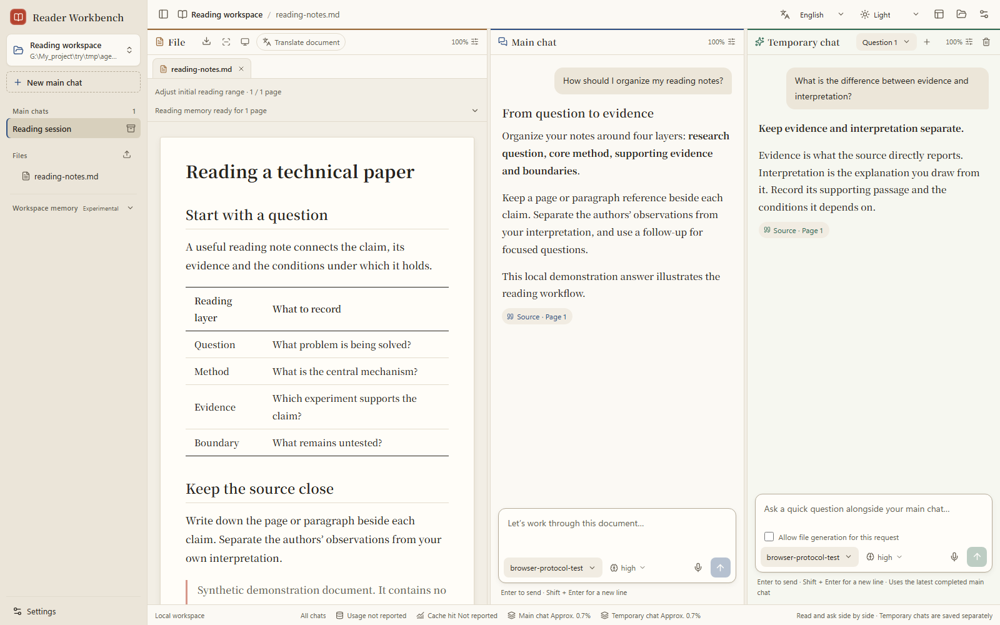

<div align="center">

# Reader Workbench

**Keep the source, your thinking and your questions side by side.**

A Windows document reading agent for personal study and research.<br>
Read papers in your own workspace, trace ideas back to their sources, and turn understanding into reading notes.

**[← 简体中文](README.md) · English**

[](https://github.com/LINYEANSHU/reader-workbench/actions/workflows/ci.yml?query=branch%3Amain)
[](#quick-start)
[](https://nodejs.org/)
[](LICENSE)

[New in 0.5.0](#new-in-050) · [Quick start](#quick-start) · [Agent architecture](#agent-architecture) · [Language switching](#language-switching) · [Documentation](#documentation)

</div>



<div align="center"><sub>Actual 0.5.0 interface · self-authored sample document · deterministic local protocol-model responses · Light theme. This demonstrates the reading workflow, not remote model answer quality.</sub></div>

## The reading experience

**Source → main chat → independent follow-up.** Read PDF, Markdown, Word, PowerPoint and images alongside the main conversation. Build understanding with reusable page memory, then select text or capture a region to ask a focused question that inherits completed main memory and keeps its own history.

- **Start with the pages you need.** Choose all pages, the first few or ranges such as `2-3,10-15` when opening PDF/Office files; read missing pages later.
- **Follow evidence back to the source.** Search terms, formulas and figures and click citations. Scans and images without a text layer are not automatically OCRed.
- **Preserve the originals.** Preview a translation and explicitly save a new file. Generated files default to `outputs/<session>/`.
- **Make room for your reading style.** Chinese/English controls, paper-inspired Light/Graphite/Lamplight themes, resizable panes with independent zoom, and offline speech input.

> **Maintained platform: Windows.** Current builds, tests, security audits and future updates cover Windows, primarily validated on Windows x64. macOS and Linux maintenance and releases have ended.

## Quick start

Install **Windows, Node.js 24+ and Git**, then run in PowerShell:

```powershell
git clone --branch main https://github.com/LINYEANSHU/reader-workbench.git
cd reader-workbench
npm ci
npm run build
npm start
```

The browser opens `http://127.0.0.1:4317` by default. After building, double-click **`Start-Reader.cmd`** for subsequent launches. Keep its window open; press `Ctrl+C` to stop the service.

**Your first reading session takes three steps:**

1. **Choose a folder.** Open a local workspace and select a document in the file tree.
2. **Connect a model.** In Settings → Model connections, enter your Base URL, model name and API key. PDF/PPT image pre-reading needs vision; Markdown/Word text reading can use a text model.
3. **Ask a question.** Try: “Explain this section's core concepts and the conditions under which its formulas apply. Include pages I can check.” For a focused question, select text and choose Ask AI, or capture a region with `Ctrl+Shift+X`.

Original-page Office previews need a separate **LibreOffice** installation. Run `node bin/reader-workbench.mjs doctor` to check dependencies; PDF, Markdown and images work independently. See [installation and troubleshooting](docs/installation.md).

<details>
<summary><strong>Install the v0.5.0 release package</strong></summary>

Download `reader-workbench-0.5.0.tgz` from the [v0.5.0 Release](https://github.com/LINYEANSHU/reader-workbench/releases/tag/v0.5.0), compare its hash with `SHA256SUMS.txt` on that page, then run in the download folder:

```powershell
Get-FileHash .\reader-workbench-0.5.0.tgz -Algorithm SHA256
npm install --global .\reader-workbench-0.5.0.tgz
reader-workbench web
```

Stop the old service before upgrading, then restart it and refresh the browser. Keep your workspace and local settings; chats, document memory and model caches do not need to be deleted. The SDK protocol remains `1.2.0`.

</details>

## New in 0.5.0

This release reduces repeated parsing, repeated input and waiting during long reading sessions.

| Reading task | What changed |
| --- | --- |
| Extended conversations | Background history summaries and staged context reduction. A provider rejection teaches a smaller input budget, stored locally for 30 days. |
| Very long questions | Models with tools receive the beginning and end, then retrieve the middle on demand. Models without tools retain the full question and report when it cannot fit. |
| Revisiting a document | Parsed documents, page images and validated document memory are cached and revalidated when the document version or cached files change. |
| PDFs, Word files and slides | Pages with a complete text layer prefer text input. Word tables and equations and PowerPoint slide structure are extracted directly; formula crops supplement text when needed. |

Streamed answers use batched writes, pre-reading handles two batches concurrently, and overviews merge newly read pages. Each chat keeps full diagnostics for its latest **20 runs**. Older finished runs lose context snapshots and repeated streaming events while **questions, final answers, status and committed chat history remain**. These implementation changes do not establish speed or answer-quality guarantees for any particular model.

## Agent architecture

**The interface supports reading; the agent assembles context and runs tools; each workspace keeps its own files and sessions.** This is a condensed edition of the existing Agent architecture diagram. Optional components participate only when configured and enabled.


| Layer | Responsibility and source |
| --- | --- |
| Reading interface | The [React workbench](apps/web/src) shows the source, main chat and follow-ups. The [Fastify API](apps/server/src) accepts requests and streams progress and answers over HTTP / SSE. [CLI](apps/cli/src) and [MCP](docs/mcp.md) entry points are also available. |
| Agent core | [RunService](packages/core/src/runs/service.ts) manages queues and runs; [ContextBuilder](packages/core/src/sessions/context.ts) assembles documents, selections, history and memory; [toolLoop](packages/core/src/runs/tool-loop.ts) coordinates the model and tools. |
| Memory and storage | [SQLite](packages/core/src/storage/workspace-store.ts) stores sessions and run state; [document memory](packages/core/src/documents/memory-store.ts) is cached by document version; optional [Cognee / Python](packages/core/src/knowledge) retrieves related workspace sources. |
| Tools and extensions | The [tool executor](packages/core/src/tools/executor.ts) validates permissions and arguments before reading documents, generating files or invoking trusted [plugins / external MCP](docs/plugins.md). The [SDK](packages/sdk/src) and [shared contracts](packages/contracts/src) define extension interfaces. |

An **OpenAI-compatible API** connects to the service you configure. Text, vision and tool support depend on the model. [Data and privacy](#data-and-privacy) explains what may leave your computer.

## Agent workflow

Each question passes through context preparation and a controlled tool loop before it becomes reusable reading history.


1. **Accept and queue.** Send the question to a main session or temporary branch. Requests within a session run in order; duplicate requests are deduplicated.
2. **Prepare reading context.** Read committed history and assemble source content, citations, page memory and summaries within the budget. Workspace retrieval participates only in non-selection questions when enabled and available. Pin the history revisions used for this run.
3. **Generate and use tools.** Stream the model response. Validate tool permissions and arguments before execution, then feed results, sources and file events back into the run. The tool loop allows up to 8 rounds.
4. **Commit and continue.** On success, commit the complete turn only to the current session and refresh the interface. Failed or cancelled runs retain their records, but unfinished turns do not enter committed conversation history.

**Main chat and follow-ups stay independent.** A temporary branch reads completed main history plus its own history; its answers never write back into main chat. Temporary branches are read-only by default. Enable “Allow file generation for this request” to create files; the default destination is `outputs/<session>/`.

<details>
<summary><strong>Implementation index: follow the diagram into the source</strong></summary>

[Requests and queueing](packages/core/src/runs/service.ts) → [Context and source scope](packages/core/src/sessions/context.ts) → [Model and tool loop](packages/core/src/runs/tool-loop.ts) → [Tool authorization](packages/core/src/tools/executor.ts) → [Session commit](packages/core/src/sessions/repository.ts).

Both diagrams preserve the structure of the Agent diagram set and adapt it to GitHub's reading width. The Chinese and English editions share the same nodes and relationships.

</details>

## Language switching

Use **界面语言 / Interface language** on the welcome page or upper-right workbench toolbar to choose **简体中文 / English**. Your browser remembers the choice and preserves the chat and draft when switching. Built-in Agent presets, expression preferences and reading instructions are available in both languages; edited custom prompts are preserved verbatim. Original documents, filenames and chat content are not automatically translated, and answers still follow your explicit language requests.

The [Chinese edition](README.md) and this English edition link to each other at the top.

## Translation and memory

### Document translation

Choose Translate document, a target language, a range, and the offline engine or your configured AI model. Preview the result, then explicitly save a new translation. Use Ask AI for selected text; the answer goes into follow-up chat.

| Source | Saved result |
| --- | --- |
| Markdown | New Markdown retaining code, formulas, links and local images. |
| Word | Full-document editable DOCX; slicing the original DOCX by preview pages is unsupported, and pagination or styles may change. |
| PDF / PowerPoint | Paired original and translated companion pages in a PDF; formulas and text inside figures remain in the original pages. |

Prepare the separate offline Chinese/English runtime, approximately 309 MiB; it is excluded from source and npm packages. On Windows x64 with Python 3.12:

```powershell
.\scripts\setup-local-translation.ps1 -Python "C:\path\to\Python312\python.exe"
```

Downloads need internet access; inference runs locally. Preview tasks do not survive a service restart, so download or save first. See [installation and repair](docs/installation.md#本地中英翻译).

### Workspace memory · experimental

Associate readable documents across a workspace and its subdirectories to retrieve small amounts of relevant source text for ordinary questions. Page memory remains independent; selection questions remain locally scoped.

```powershell
node scripts/setup-workspace-memory.mjs
```

Requires Python 3.10–3.14; 3.11 is recommended. Restart after setup, then use Workspace memory in the sidebar to inspect progress, search sources or refresh files. Indexes stay under `.reader-workbench/knowledge/`. Discovery excludes hidden directories, outputs, credential-like filenames and symbolic links, and respects `.gitignore` and `.readerignore`.

This is experimental: at most 5,000 files per discovery, each up to 64 MiB, with no automatic OCR. Small-sample checks do not establish complex Chinese relationship or mathematical reasoning quality. See [setup and limitations](docs/workspace-memory.md).

## Data and privacy

Originals stay in their folders. Caches, page memory and chat history live under the workspace's `.reader-workbench/`. Model connections, keys, prompts and selections live in the computer's private user configuration directory and are shared across workspaces.

**Using a remote model sends the text, memory and page images needed for your question to the service you configure.** Offline speech recognition produces an editable draft; the LLM is called only after you send it.

The repository ignores local instructions, private settings, keys, databases, model runtimes, logs, review evidence, test results and generated packages. Keep personal material in ignored folders such as `private/` or `local-data/`, or add your own rules. `.gitignore` does not remove files already tracked by Git.

Execution grants for directory plugins and external MCP commands are bound to the local machine, workspace and code digest. Updates may require trusting them again in Settings. See [plugins and permissions](docs/plugins.md).

## Development and verification

Windows CI runs the dependency security audit, fixture integrity checks, type checking, build, repeated native screen-capture checks, unit/integration tests and browser tests for the same commit. See [actual runs for this branch](https://github.com/LINYEANSHU/reader-workbench/actions/workflows/ci.yml?query=branch%3Amain).

```powershell
npm audit --audit-level=low --registry=https://registry.npmjs.org
npm run typecheck
npm run build
npm test
npm run test:e2e
```

The full suite requires LibreOffice, Chinese fonts, Playwright browsers and speech assets; see [verification requirements and historical results](docs/verification.md). To update, stop the service, save your changes, then run `git pull --ff-only`, `npm ci` and `npm run build`. Keep the original workspace and private configuration.

## Documentation

[Installation](docs/installation.md) · [Changelog](CHANGELOG.md) · [Workspace memory](docs/workspace-memory.md) · [Plugins / Python / external MCP](docs/plugins.md) · [HTTP API](docs/api.md) · [MCP service](docs/mcp.md) · [Third-party components](docs/THIRD_PARTY.md)

Supporting technical documents currently use Chinese unless otherwise indicated.

## License

Project source is available under the **[Apache License 2.0](LICENSE)**. Third-party dependencies, speech models and translation models retain their own licenses and terms; see [third-party notices](docs/THIRD_PARTY.md).
