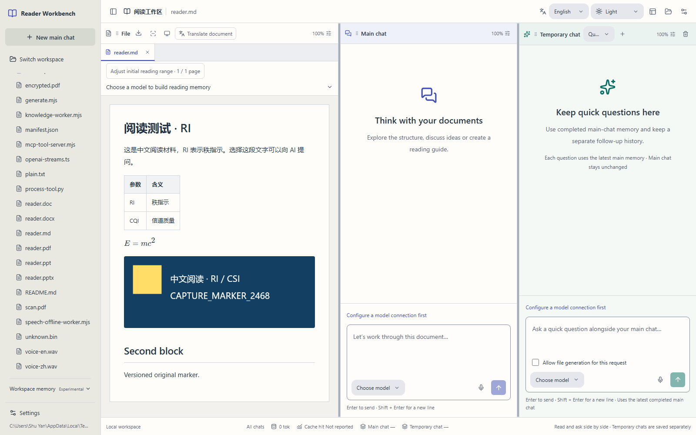
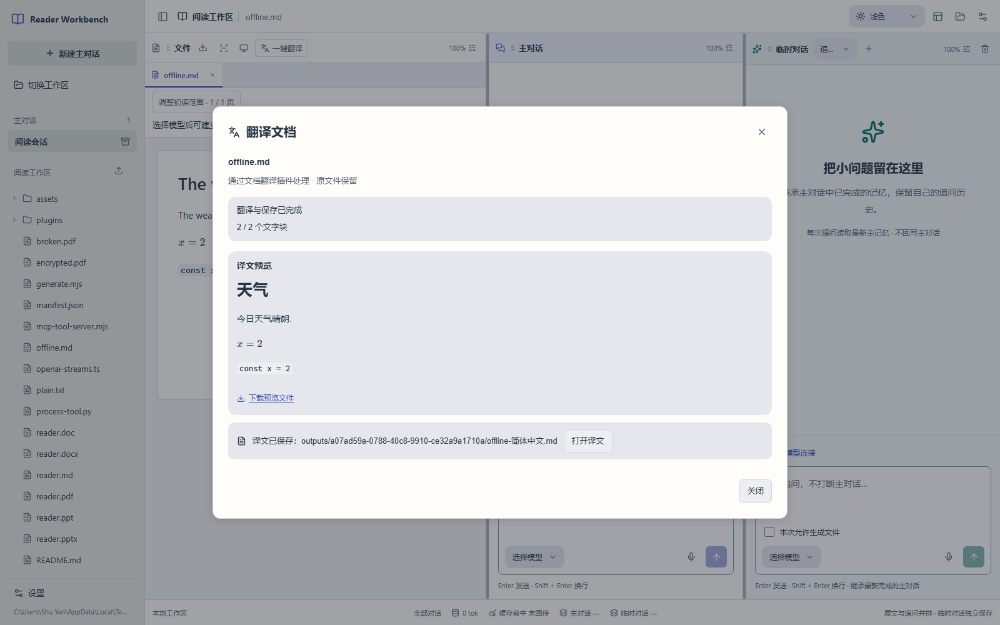

# Reader Workbench

**[简体中文](README.md) · [English](README.en.md)**

Read source documents, develop an analysis and ask focused follow-up questions side by side, in one local workspace.

[](https://github.com/LINYEANSHU/reader-workbench/releases/tag/v0.4.0)
[](https://nodejs.org/)
[](https://github.com/LINYEANSHU/reader-workbench/actions/workflows/ci.yml)

For personal study and research: read papers, course materials and professional documents; check formulas, figures and sources; then create your own reading notes. Use local files and your own model service with Markdown, PDF, Word, PowerPoint and images.



*An actual English interface capture using synthetic source material. The original Chinese content is preserved. It demonstrates the workflow, not model answer quality.*

[Quick start](#quick-start) · [Interface languages](#interface-languages) · [First use](#first-use) · [Workspace memory](#workspace-memory-experimental) · [Upgrade](#upgrade)

## Current source and published release

The current source adds a **switchable Chinese/English interface**, **experimental workspace memory** and search-state fixes on top of 0.4.0. Build from source below to use them. The published `reader-workbench-0.4.0.tgz` does not include these later source updates. This update creates no new release tag; the application package version remains **0.4.0**, and the SDK protocol remains **1.2.0**.

Published 0.4.0 introduced reading ranges, source search, local/AI translation, chat archiving, shared AI settings, improved folder selection and startup reliability. See the [changelog](CHANGELOG.md) for the complete history.

## Interface languages

Choose **简体中文** or **English** with **界面语言 / Interface language** on the welcome page or the upper-right workbench toolbar. Chinese is the default. Your browser remembers the choice across reloads and workspace changes; the page language and title follow it. Switching languages preserves the current chat and draft.

The selection changes application controls only. Source documents, filenames, chat bodies, translation targets and saved prompts retain their content. AI answer language is determined by your question and model instructions. The two README editions link to each other at the top.

## Workspace memory (experimental)

The current source can associate readable documents across a workspace and its subdirectories. Ordinary questions may retrieve a small amount of related source text from other files. Existing page memory remains independent; selection questions stay locally scoped.

Prepare the separate local runtime once from the application directory:

```sh
node scripts/setup-workspace-memory.mjs
```

Requires Python 3.10–3.14; 3.11 is recommended. The installer prefers uv and also supports Python venv/pip. Dependency and model downloads need internet access. Normal indexing uses local models, does not reuse your LLM API key and disables Cognee telemetry.

Restart the workbench, choose a workspace and expand **Workspace memory** in the sidebar:

- Inspect association progress, merged duplicates and reasons files were not associated. No course naming convention or manual tags are required.
- Search in your own words and click a result's source to open the original. Ordinary chat can retrieve a small amount of related evidence automatically.
- Choose **Refresh associated files** to rebuild manually, or turn off **Automatically associate workspace files**. The switch is shared across workspaces; indexes remain separate.
- Editing a query, refreshing files or disabling memory clears old results. Status checks can recover after failure, and cancelled searches cannot publish a late result.

Before evidence is used, file versions, exclusion rules and reading-page ranges are checked again. Hidden directories, dependencies, build/output directories, credential-like filenames and symbolic links are excluded by default. Discovery also respects nested `.gitignore` and optional `.readerignore` files. For example, add `private/` to the workspace's `.readerignore` to exclude private material. Indexing exclusions and Git exclusions serve different purposes.

**Experimental limits:** Uses Cognee 1.6.5; the upstream GLiNER integration is a demo. Small-sample tests do not establish large-workspace Chinese relationship or mathematical reasoning quality. Images and scans without text layers are not automatically OCRed. Each discovery handles at most 5,000 files, each up to 64 MiB. Indexes stay under `.reader-workbench/knowledge/` in the workspace. See [setup, limits and API](docs/workspace-memory.md).

## Quick start

Requires **Node.js 24+**. Original-page Office previews require local LibreOffice. PDF, Markdown and images work independently. Run `reader-workbench doctor` to check dependencies.

### Install the published package

Download `reader-workbench-0.4.0.tgz` from the [v0.4.0 release](https://github.com/LINYEANSHU/reader-workbench/releases/tag/v0.4.0), then run these commands in the download directory:

```sh
npm install --global ./reader-workbench-0.4.0.tgz
reader-workbench web
```

The browser opens `http://127.0.0.1:4317` by default.

### Build the current source

```sh
git clone https://github.com/LINYEANSHU/reader-workbench.git
cd reader-workbench
npm ci
npm run build
npm start
```

On Windows, double-click `Start-Reader.cmd` after building, or run `Start-Reader.ps1` in a terminal. Keep the launcher window open and press `Ctrl+C` to stop. A failed launch keeps its error visible. See [installation and troubleshooting](docs/installation.md) for ports, dependencies and installation paths. Supporting technical documents currently use Chinese unless otherwise indicated.

## First use

1. **Choose a workspace.** Select an existing folder and keep its directory structure. Import files when needed; generated results default to `outputs/<session>/`.
2. **Configure a model.** Open Settings → Model connections, enter a Base URL, model name and API key, then save. Connections and selections are shared across local workspaces. PDF/PPT image pre-reading needs vision; Markdown/Word text and translation can use text models.
3. **Open a document.** Use the file tree or import a file. Office documents convert locally. On first PDF/Office opening, select all pages, the first few or ranges such as `2-3,10-15`. Saving the range does not call a model.
4. **Ask in the main chat.** The first question builds page memory within the selected range; later questions reuse it. For example: “Explain this section's concepts and the conditions under which its formulas apply. Include pages I can check.” Missing-page reading reuses completed memory.
5. **Ask a focused follow-up.** Select text and choose Ask AI, or capture a region with the default `Mod+Shift+X`. You can also type directly in follow-up chat.

| Documents | Main chat | Follow-up chat |
| --- | --- | --- |
| Read sources and inspect citations and page memory | Develop an analysis, accumulate main memory and generate reading materials | Inherit the latest completed main memory and retain an independent follow-up history |

Follow-up answers do not write into the main chat. Main chat can generate files; follow-up chat is read-only by default, with a per-request file-creation option. Generated files live in `outputs/<session>/`; originals are preserved.

Input capacity is fixed at **1,000,000 tokens**. Output length uses the model provider's default; there is no output-limit control.

## Reading, translation and organization

### Reading ranges and source search

Choose an initial range when opening a PDF/Office document. Saving only stores the plan; the first question calls the model. PDF/PPT send selected page images; Markdown/Word use extracted text; selection questions send relevant selected text.

Expand reading memory in Documents to adjust the range, read missing pages and search formulas, figures or terms. Click a result to open its source. Page citations navigate to a page; text sources locate content where supported. Completion of the selected range and the full document are shown separately. The panel also displays individual page memories and offers rebuilding; disable it in Settings → Plugins.

### Translate a document

1. Choose Translate document. To understand or translate selected text, choose Ask AI from the selection menu instead; the answer appears in follow-up chat and no file is saved.
2. Select a provider, target language and range. Local offline Chinese/English translation is the default; a configured AI model is also available.
3. Start translation and inspect or download the preview. Processing can be cancelled.
4. Save a new translation, then open it to continue reading. Only explicit saving writes a workspace file.



*A synthetic document translated by the actual offline engine. Check technical terminology against the original.*

| Source | Translation output and limits |
| --- | --- |
| Markdown | New Markdown retaining code, formulas, links and local images. |
| Word | New editable DOCX for full-document translation. Preview-page slicing of the original DOCX is unsupported; styles and pagination may change. |
| PDF / PowerPoint | Extracted text translated into a paired PDF with original and translated companion pages. Formulas and text inside figures remain in the originals. |

Scans without text layers are not automatically OCRed. Preview tasks do not survive a service restart; download or save before stopping the service.

Prepare the separate offline runtime, approximately 309 MiB, which is excluded from source and release packages. On Windows x64 with Python 3.12:

```powershell
.\scripts\setup-local-translation.ps1 -Python "C:\path\to\Python312\python.exe"
```

Downloads require internet access; inference runs locally. `READER_TRANSLATION_RUNTIME` selects a custom runtime. Installer deployment validation currently covers Windows x64; macOS/Linux can use a configured AI model. See [installation and repair](docs/installation.md#本地中英翻译).

### Chats, appearance and preferences

Archive a main chat in the sidebar and restore its history and follow-up branches from Archived. If all chats are archived, create or restore one manually. Missing old workspace folders are not recreated automatically.

Connections, keys, prompts, selected models, reasoning levels and shortcuts are shared across workspaces. Upgrades migrate old configuration with protected backups. Files, chats and translations remain workspace-scoped.

Choose Light, Graphite or Ink with Appearance; the browser remembers your choice. Layout presets and drag controls arrange the three panes. Each pane's body independently zooms from **50–200%**, without enlarging toolbars or composers.

Settings → Prompts and personalization lets you choose a style, edit system/personal instructions and preview the composed prompt. Save to apply it to the **next question**. Source-verification and workspace-permission rules continue to accompany requests. These controls affect answers; Appearance controls colors.

The reasoning control beside each composer opens a slider for the selected model's supported levels. Main and follow-up choices are separate. `Escape` closes it and restores focus. Use the trash button in the follow-up pane header to clear that branch; source files, main history and accumulated usage remain.

### Usage and context

The All chats footer aggregates the current workspace's main and follow-up token usage, including tools, pre-reading, compaction and historical model configurations. Clearing or switching a chat does not reset totals. Cache hit rate is weighted by reported input tokens; missing reports are marked rather than treated as zero. Per-connection totals remain under Model connections.

Current context occupancy is shown separately for the open chats/models, with local estimates distinguished from service reports. Totals cover calls recorded since the feature was enabled, not earlier requests or your provider account balance.

Near context capacity, checkpoints preserve goals, corrections, key facts, sources and unfinished work alongside recent turns. Original history remains intact if compaction fails. Compaction calls count toward usage; verify summary details against the source.

## Local data and model services

Source files stay at their original locations; generated files stay in the workspace. Caches, page memory and chat history live under `.reader-workbench/`. Model connections, keys, prompts and selections live in the computer's private `agent/` configuration directory and are shared across workspaces.

**When you use a remote model, text, memory and page images needed for your question are sent to the service you configure.** Persistent local memory is not a persistent session at the model provider. Markdown/plain text use text parsing; disable visual memory when using a text model with OCR.

Both composers support offline SenseVoice speech input. First use prepares approximately 240 MB of models; recording produces an editable draft and calls the LLM only when you send it. Plugin SDK, Python tools, external MCP, HTTP API and MCP stdio/HTTP entry points remain available.

Local `Agents.md`, private configuration, keys, runtimes, databases, logs, test reports and generated packages are excluded from the repository. Configure your own ignore files for private source material as needed.

## Upgrade

Stop the old service and save or commit your changes. From the source repository root:

```sh
git pull --ff-only
npm ci
npm run build
npm start
```

Package users can reinstall a newer `.tgz`. Refresh the browser after restarting. Keep the original workspace and private configuration directory; do not delete history, caches or the repository, or run `git clean -fdx`.

## Documentation and validation

See the [2026-10-22 source validation](docs/evidence/2026-10-22/bilingual/validation.md) for bilingual-interface, workspace-memory and actual local-engine checks.

```sh
npm run typecheck
npm run build
npm test
npm run test:e2e
```

See the [0.4.0 release validation](docs/evidence/2026-10-19/release-0.4.0/validation.md) for that release's package and credential checks. Interaction tests use local protocol models; optional real-engine tests require explicitly configured resources. Earlier real remote-model records retain their own dates and scope in the [visual memory record](docs/evidence/2026-10-12/visual-memory-live.json).

Before publishing, check Windows, macOS and Linux builds and automated tests for the **same commit SHA** in [GitHub Actions](https://github.com/LINYEANSHU/reader-workbench/actions/workflows/ci.yml). Skipped environment-gated tests do not validate their engines. Office, physical microphones, manual OS pickers and optional global-hotkey helpers have separate requirements; real LLM tests require separate authorization.

- [Installation and repair](docs/installation.md) · [Changelog](CHANGELOG.md) · [Validation methods](docs/verification.md)
- [Workspace memory](docs/workspace-memory.md) · [Plugins / Python / external MCP](docs/plugins.md) · [HTTP API](docs/api.md) · [MCP service](docs/mcp.md)
- [Current delivery](docs/current-delivery.md) · [Versioning](docs/versioning.md) · [Third-party licenses](docs/THIRD_PARTY.md)
