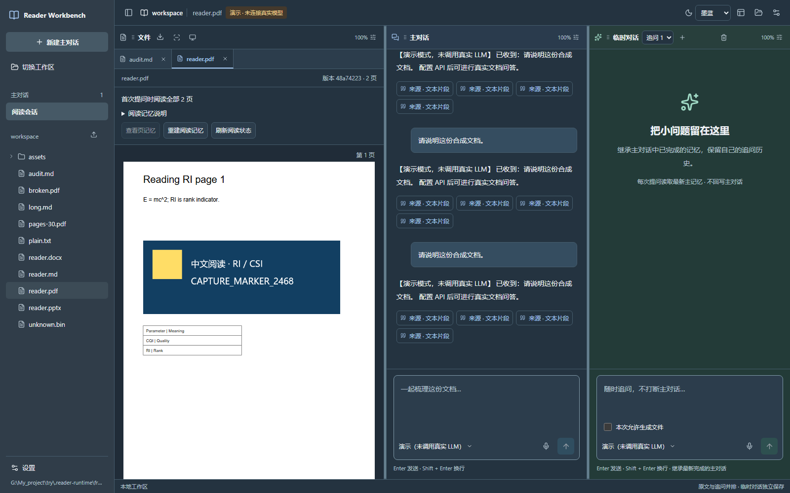
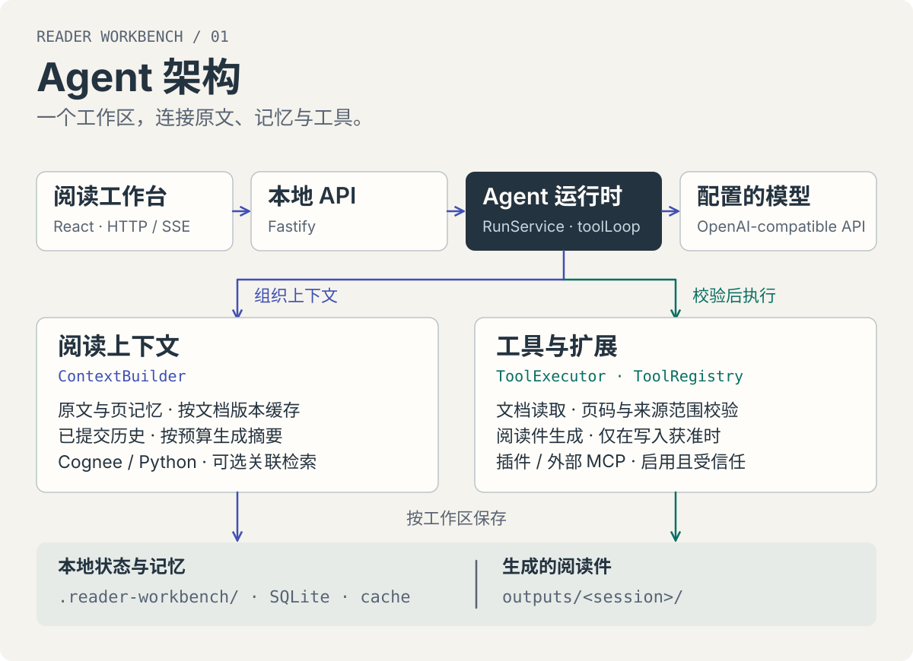
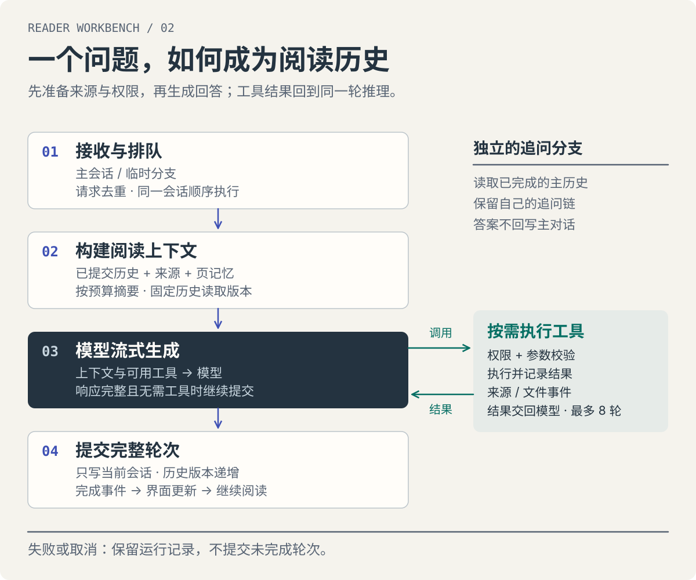

<div align="center">

# Reader Workbench · 阅读工作台

**把原文、思考与追问放在同一张桌面上。**

面向个人学习与科研的 Windows 文档阅读 Agent。<br>
在自己的工作区读论文、看课件，用可回查的来源串起理解，再生成自己的阅读件。

**简体中文 · [English →](README.en.md)**

[](https://github.com/LINYEANSHU/reader-workbench/actions/workflows/ci.yml?query=branch%3Amain)
[](#快速开始)
[](https://nodejs.org/)
[](LICENSE)

[快速开始](#快速开始) · [Agent 架构](#agent-架构) · [运行工作流](#运行工作流) · [翻译与记忆](#翻译与记忆) · [文档](#文档)

</div>



<div align="center"><sub>真实应用 · 合成示例文档 · 墨蓝外观。截图展示阅读流程，不代表模型回答质量；当前界面细节可能有所更新。</sub></div>

## 阅读方式

**原文 → 主对话 → 独立追问。** 左侧核对 PDF、Markdown、Word、PowerPoint 和图片；主对话积累理解与页记忆；选字或截图开启局部追问，继承已完成的主记忆并保留独立历史。

- **先读需要的页。** 首次打开 PDF/Office 时选择全部、前几页或 `2-3,10-15`，后续补读缺失页面。
- **沿着来源回原文。** 搜索术语、公式和图表，点击引用回看；扫描件与无文字层图片不自动 OCR。
- **整理时保留原文件。** 预览译文后显式另存，生成结果默认写入 `outputs/<session>/`。
- **按自己的习惯阅读。** 中英文界面、浅色/石墨/墨蓝外观、可拖动三栏与独立缩放、离线语音输入。

> **维护范围：Windows。** 当前版本只提供 Windows 构建、测试、安全审计和后续更新，主要验证环境为 Windows x64。macOS 与 Linux 停止维护和发布。

## 快速开始

准备 **Windows、Node.js 24+、Git**，在 PowerShell 中运行：

```powershell
git clone --branch main https://github.com/LINYEANSHU/reader-workbench.git
cd reader-workbench
npm ci
npm run build
npm start
```

浏览器默认打开 `http://127.0.0.1:4317`。以后可直接双击 **`Start-Reader.cmd`** 启动；保持启动窗口打开，按 `Ctrl+C` 停止服务。

**第一次使用只需三步：**

1. **选资料目录。** 打开本地工作区，从文件树选择一份文档。
2. **连接模型。** 在「设置 → 模型连接」填写 Base URL、模型名和 API Key。PDF/PPT 图像预读需要视觉模型；Markdown/Word 文本阅读可用文字模型。
3. **开始提问。** 例如：「解释本节的核心概念和公式适用条件，并标出可以核对的页码。」局部疑问可选中文字后点「询问 AI」，或使用 `Ctrl+Shift+X` 截图。

Office 原版页面预览需要另行安装 **LibreOffice**。安装后运行 `node bin/reader-workbench.mjs doctor` 检查依赖；PDF、Markdown 和图片可独立使用。详细步骤见[安装与运行](docs/installation.md)。

<details>
<summary><strong>已有 v0.4.0 发行包？</strong></summary>

已发布的 [v0.4.0](https://github.com/LINYEANSHU/reader-workbench/releases/tag/v0.4.0) 是历史版本，不包含后续的双语界面、工作区记忆及本次修复。要使用当前功能，请按上面的源码步骤安装。应用包版本仍为 `0.4.0`，SDK 协议为 `1.2.0`；本次不创建新发布标签。

安装已有包可执行 `npm install --global .\reader-workbench-0.4.0.tgz`，随后运行 `reader-workbench web`。

</details>

## Agent 架构

**界面负责阅读，Agent 负责组织上下文与工具，文件和会话按工作区保存。** 下面是现有 Agent 架构图的 README 精简版；图中的可选组件只在配置并启用后参与运行。



| 层次 | 职责与源码入口 |
| --- | --- |
| 阅读入口 | [React 工作台](apps/web/src)呈现原文、主对话和追问；[Fastify API](apps/server/src)通过 HTTP / SSE 接收请求、推送进度与回答。另提供 [CLI](apps/cli/src) 和 [MCP](docs/mcp.md) 入口。 |
| Agent 核心 | [RunService](packages/core/src/runs/service.ts)管理排队与运行；[ContextBuilder](packages/core/src/sessions/context.ts)组织文档、选区、历史和记忆；[toolLoop](packages/core/src/runs/tool-loop.ts)协调模型与工具。 |
| 记忆与存储 | [SQLite](packages/core/src/storage/workspace-store.ts)保存会话和运行状态；[文档记忆](packages/core/src/documents/memory-store.ts)按文档版本缓存；可选 [Cognee / Python](packages/core/src/knowledge)提供工作区关联检索。 |
| 工具与扩展 | [工具执行器](packages/core/src/tools/executor.ts)校验权限和参数，再调用文档读取、文件生成或已信任的[插件 / 外部 MCP](docs/plugins.md)；[SDK](packages/sdk/src)与[共享契约](packages/contracts/src)定义扩展接口。 |

模型通过 **OpenAI-compatible API** 接入你配置的服务；文字、视觉和工具调用能力取决于该模型。[数据与隐私](#数据与隐私)说明了哪些内容会离开本机。

## 运行工作流

从一个问题到可继续复用的阅读历史，中间有一次完整的上下文构建和受控工具循环。



1. **接收与排队。** 问题进入主会话或临时分支，同一会话按顺序处理，重复请求去重。
2. **准备阅读上下文。** 读取已提交历史，按预算组织原文、来源、页记忆与摘要；工作区检索仅在启用且可用的非选区问题中参与，随后固定本次读取的历史版本。
3. **生成与调用工具。** 模型流式回答；需要工具时先校验权限与参数，再把工具结果、来源和文件事件接回运行。工具循环最多 8 轮。
4. **提交并继续阅读。** 完整回答成功后，只提交到当前会话并更新界面；失败或取消保留运行记录，但未完成轮次不进入已提交的会话历史。

**主对话与追问保持独立。** 临时追问读取已完成的主历史与自己的历史，答案不回写主对话。临时分支默认只读；生成文件需勾选当次的「本次允许生成文件」，默认输出到 `outputs/<session>/`。

<details>
<summary><strong>实现索引：从图中的路径进入源码</strong></summary>

[请求与排队](packages/core/src/runs/service.ts) → [上下文与来源范围](packages/core/src/sessions/context.ts) → [模型与工具循环](packages/core/src/runs/tool-loop.ts) → [工具授权](packages/core/src/tools/executor.ts) → [会话提交](packages/core/src/sessions/repository.ts)。

两张图沿用 Agent 图集的结构，并针对 GitHub 阅读宽度重新排版；中英文版本使用相同节点与关系。

</details>

## 中英文切换

欢迎页和工作台右上角的 **界面语言 / Interface language** 可切换 **简体中文 / English**。浏览器保存选择，切换时保留对话和输入草稿。原文、文件名及聊天内容保持原样；AI 的回答语言由提问与模型提示词决定。

本文档的[英文版本](README.en.md)与中文版本在顶部互相链接。

## 翻译与记忆

### 文档翻译

点击「一键翻译」，选择语言、范围和本地离线引擎或已配置的 AI 模型，预览后再点「另存译文」。选区的解释或翻译通过「询问 AI」进入临时对话。

| 原文 | 另存结果 |
| --- | --- |
| Markdown | 保留代码、公式、链接和本地图片的新 Markdown。 |
| Word | 全文翻译为可编辑 DOCX；不支持按预览页切割原 DOCX，分页和样式可能变化。 |
| PDF / PowerPoint | 原页与译文伴读页配对的 PDF；图内文字和公式保留在原页。 |

离线中英翻译运行库需单独准备，约 309 MiB，不随源码或 npm 包发布。在 Windows x64 上使用 Python 3.12：

```powershell
.\scripts\setup-local-translation.ps1 -Python "C:\path\to\Python312\python.exe"
```

安装下载需要联网，推理在本地运行。译文预览任务不会跨服务重启保留，请先下载或另存。见[安装与修复](docs/installation.md#本地中英翻译)。

### 工作区关联记忆 · 试验

关联同一工作区及子目录中的可读资料，为普通问题检索少量相关原文。逐页文档记忆保持独立，选区问题保持局部范围。

```powershell
node scripts/setup-workspace-memory.mjs
```

需要 Python 3.10–3.14，推荐 3.11。准备后重启，在侧栏「工作区记忆」查看进度、检索出处或更新资料。索引留在 `.reader-workbench/knowledge/`；默认排除隐藏目录、输出、凭据类文件和符号链接，并尊重 `.gitignore` 与 `.readerignore`。

这是实验功能：单次最多 5,000 份资料、每份最多 64 MiB，不自动 OCR，不将小样验证视为复杂中文关系或数学推理质量保证。完整边界见[工作区记忆](docs/workspace-memory.md)。

## 数据与隐私

原文件留在原目录；缓存、页记忆和聊天历史位于工作区的 `.reader-workbench/`。模型连接、密钥、提示词和选择保存在本机用户配置目录，跨工作区共用。

**使用远程模型时，回答所需的文本、记忆与页面图像会发送给你配置的服务。** 离线语音识别先产生可编辑草稿，发送后才调用 LLM。

仓库忽略本地指令、私有配置、密钥、数据库、模型运行库、日志、审查证据、测试结果与生成包。自行放入仓库的私人资料请使用被忽略的 `private/`、`local-data/` 等目录，或补充自己的忽略规则。`.gitignore` 不会自动撤回已经跟踪的文件。

目录插件和外部 MCP 的执行授权绑定本机、工作区及代码摘要；更新后可能需要在设置中重新信任。详见[插件与权限](docs/plugins.md)。

## 开发与验证

Windows CI 对同一提交执行依赖安全审计、样例完整性检查、类型检查、构建、原生截图重复测试、单元/集成测试及浏览器端测试。查看[当前分支的实际运行结果](https://github.com/LINYEANSHU/reader-workbench/actions/workflows/ci.yml?query=branch%3Amain)。

```powershell
npm audit --audit-level=low --registry=https://registry.npmjs.org
npm run typecheck
npm run build
npm test
npm run test:e2e
```

完整测试需要 LibreOffice、中文字体、Playwright 浏览器和语音资源；配置方法与历史验收边界见[验证说明](docs/verification.md)。更新源码前停止服务并保存改动，再运行 `git pull --ff-only`、`npm ci` 和 `npm run build`；保留原工作区及私有配置。

## 文档

[安装与运行](docs/installation.md) · [更新记录](CHANGELOG.md) · [工作区记忆](docs/workspace-memory.md) · [插件 / Python / 外部 MCP](docs/plugins.md) · [HTTP API](docs/api.md) · [MCP 服务](docs/mcp.md) · [第三方组件](docs/THIRD_PARTY.md)

## 许可证

本项目源码以 **[Apache License 2.0](LICENSE)** 开源。第三方依赖、语音和翻译模型保留各自的许可证及使用条款，见[第三方组件说明](docs/THIRD_PARTY.md)。
