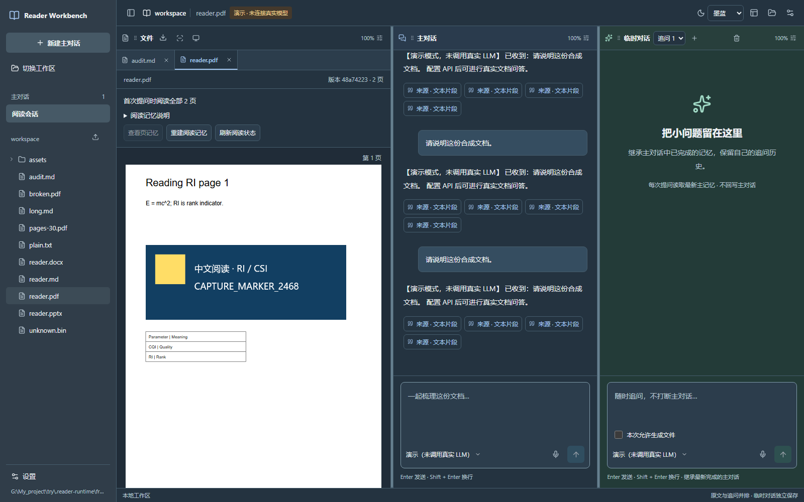
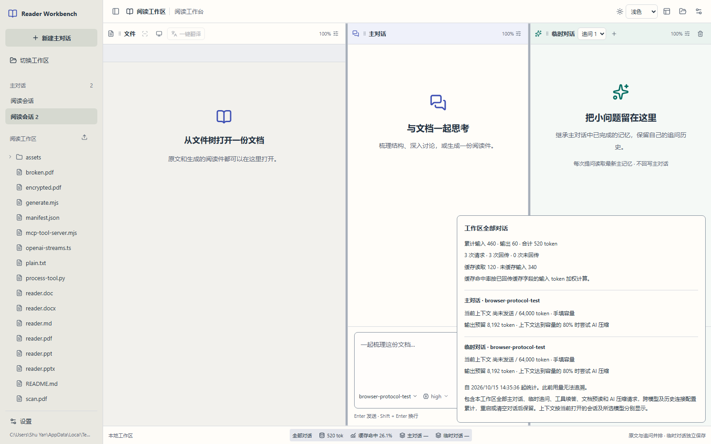

# Reader Workbench · 阅读工作台

**[简体中文](README.md) · [English](README.en.md)**

**原文、主对话与临时追问并排打开，让文档阅读、理解和整理留在同一个工作区。**

[](https://github.com/LINYEANSHU/reader-workbench/releases/tag/v0.4.0)
[](https://nodejs.org/)
[](https://github.com/LINYEANSHU/reader-workbench/actions/workflows/ci.yml)

面向个人学习与科研：阅读论文、课件和专业资料，核对公式、图表与来源，再生成自己的阅读件。使用本地文件和自己配置的模型服务，支持 Markdown、PDF、Word、PowerPoint 和图片。



*真实应用的合成文档验证截图，展示三栏阅读与墨蓝外观。新版合并统计栏见下方；截图不作为模型回答质量证明。*

[快速开始](#快速开始) · [中英文界面](#中英文界面) · [工作区记忆试验](#工作区关联记忆试验) · [新版变化](#v040-有什么变化) · [首次阅读](#第一次使用) · [升级](#从旧版本升级)

## 当前源码新增功能

当前源码在 0.4.0 基础上加入了**可切换的中英文界面**、**工作区关联记忆试验**和检索状态修复。使用下面的“从源码运行”获取这些功能。已发布的 `reader-workbench-0.4.0.tgz` 不包含这些后续源码更新；本次不创建新版本标签，应用包版本仍为 0.4.0。

## 中英文界面

欢迎页和工作台右上角的 **界面语言 / Interface language** 可选择 **简体中文** 或 **English**。默认中文，浏览器保存选择；刷新或切换工作区后继续使用。切换时保留对话和输入草稿，页面语言标记与标题同步更新。

界面语言只改变应用控件。原文、文件名、聊天正文、翻译目标及已保存提示词保持原样；AI 回答语言仍由提问和模型提示词决定。两份 README 在页面顶部互相链接。

## 工作区关联记忆（试验）

当前源码可自动关联工作区及子目录的可读取资料，让普通问题得到其他文件的少量相关原文。现有逐页文档记忆继续独立工作，选区问题保持局部范围。

在应用安装目录准备独立运行库：

```sh
node scripts/setup-workspace-memory.mjs
```

需要 Python 3.10–3.14，推荐 3.11；安装器优先使用 uv，也支持 Python venv/pip。下载依赖和模型时需要联网，正常索引使用本地模型，不复用 LLM API Key，关闭 Cognee 遥测。完成后重启工作台，选择工作区并展开侧栏“工作区记忆”：

- 查看关联进度、重复内容合并与未关联原因，无需课程命名或手工标签。
- 输入问题检索，点击出处回原文；普通提问可自动取得少量关联证据。
- 用“更新关联资料”手动重建，或关闭“自动关联工作区资料”。开关跨工作区共用，索引按工作区隔离。
- 修改问题、更新资料或关闭功能时清除旧结果；状态请求失败可恢复，不把旧结果当成新问题的证据。

来源使用前会重新核验版本、排除规则及首读范围。默认排除隐藏目录、依赖、构建、输出、凭据类文件和符号链接，也尊重各级 `.gitignore` 与可选 `.readerignore`。例如可在工作区的 `.readerignore` 写入 `private/` 排除私人资料；资料索引排除与 Git 提交排除是不同用途。

**试验边界：** 使用 Cognee 1.6.5，上游 GLiNER 集成为 demo；小样通过不代表大型工作区、复杂中文关系或数学推理质量已验收。扫描件与图片不自动 OCR。单次最多 5,000 份资料、单份最多 64 MiB，索引留在工作区 `.reader-workbench/knowledge/`。完整准备步骤、限制和 API 见 [工作区记忆](docs/workspace-memory.md)。

## v0.4.0 有什么变化

**先读需要的页，按来源回看，再把译文另存。** 本版把阅读范围、来源检索和文档翻译接入同一条阅读流程，并改进工作区与对话管理。

| 新功能 | 怎么用 |
| --- | --- |
| 按范围首读与补读 | 首次打开 PDF/Office 时选择全部、前几页或 `2-3,10-15`；在文件栏调整范围，后续提问复用已有页记忆。 |
| 公式、图表与术语检索 | 展开阅读记忆面板，输入公式编号或中文描述，点击结果回到原文；来源标明页级或文字定位。 |
| 文档与选区翻译 | 文件栏点“一键翻译”，或选字右键“翻译所选文字”；选择语言，预览后点“另存译文”，保留原文件。 |
| 本地中英离线翻译 | 准备私有翻译运行库后使用默认的“本地离线翻译”，无需 API Key；也可选择已配置的 AI 模型。 |
| 更好用的工作区和菜单 | 通过目录树、地址栏、面包屑及前进后退选文件夹；模型列表支持搜索，常用图标提供悬停和键盘提示。 |
| 主对话归档与恢复 | 在侧栏归档主对话，从“已归档”恢复；全部归档后保持空状态，手动新建后继续。 |
| 跨工作区共用 AI 设置 | 模型连接、密钥、提示词、模型选择、思考档位及快捷键迁入用户配置目录；文档和历史仍留在各自工作区。 |
| 启动与阅读稳定性 | Windows 双击 `Start-Reader.cmd` 启动；已删除的工作目录不会被重建，文档记忆可缩小批次重试。 |

三套外观、三栏布局、提示词个性化、思考控制、上下文压缩和用量统计继续可用。输入容量固定为 **1,000,000 tokens**，输出长度使用模型供应商默认值，不再提供输出上限设置。应用版本为 **0.4.0**；SDK 协议保持 **1.2.0**。完整变化见 [CHANGELOG](CHANGELOG.md)。

## 快速开始

需要 **Node.js 24 或更新版本**。Office 原版页面预览需要本机 LibreOffice；PDF、Markdown 和图片可独立使用。运行 `reader-workbench doctor` 可检查依赖。

### 使用发行包

从 [v0.4.0 Release](https://github.com/LINYEANSHU/reader-workbench/releases/tag/v0.4.0) 下载 `reader-workbench-0.4.0.tgz`，在下载目录执行：

```sh
npm install --global ./reader-workbench-0.4.0.tgz
reader-workbench web
```

浏览器默认打开 `http://127.0.0.1:4317`。

### 从源码运行

```sh
git clone https://github.com/LINYEANSHU/reader-workbench.git
cd reader-workbench
npm ci
npm run build
npm start
```

Windows 构建后，双击仓库根目录的 `Start-Reader.cmd` 即可启动并自动打开浏览器。也可在终端运行：

```powershell
.\Start-Reader.cmd
```

使用期间保持启动窗口打开，按 `Ctrl+C` 或关闭窗口停止服务；启动失败时窗口会保留错误提示。脚本复用既有本地配置及可用的 Office、语音资源；原有 `Start-Reader.ps1` 仍可使用。安装位置、其他端口和依赖准备见 [安装与运行](docs/installation.md)。

## 第一次使用

当前开发分支另有未发布的 **Cognee 工作区记忆试验**：自动关联同一工作区及子目录中的资料、合并重复内容，并保留原文出处，无需课程分类。一次准备本地组件后自动使用；详见[工作区记忆试验](docs/workspace-memory.md)。它不属于已发布的 v0.4.0 功能。

1. **选择工作区。** 打开保存论文、课件或资料的本机文件夹；文件、会话和生成结果按工作区隔离。
2. **连接模型。** 打开“设置 → 模型连接”，展开“模型配置”，填写 Base URL、模型名称和 API Key，再保存。连接与选择在本机所有工作区共用。PDF/PPT 图像预读需要视觉模型；Markdown/Word 文本预读和翻译可使用文字模型。
3. **打开文档。** 从左侧文件树选择文件，或导入文件。Office 文档先在本地转换；首次打开 PDF/Office 时可选择全部、前几页或多段首读范围，保存范围不会调用模型。
4. **在主对话提问。** 例如：“先讲清本节核心概念，再解释公式的适用条件，并标注可以核对的页码。”首次按设定范围及模型限制分批建立页记忆；后续复用缓存，补读只处理缺少记忆的页面。
5. **随时局部追问。** 选中文字后右键“询问 AI”，或用默认 `Mod+Shift+X` 截图；也可直接在临时对话输入问题。

| 文件栏 | 主对话 | 临时对话 |
| --- | --- | --- |
| 阅读原文、查看来源与页记忆 | 持续分析、积累主记忆、生成阅读件 | 继承最新已完成的主记忆，保留自己的追问链 |

临时答案不回写主对话。主对话可生成文件；临时对话默认只读，需要生成时勾选当次的“本次允许生成文件”。生成结果位于工作区内的 `outputs/<session>/`，原文件保留。

## 新版功能怎么用

### 只读需要的页，再按来源回看

打开 PDF/Office 后，在“初次阅读范围”选择“前几页”或“自定义页码”，例如 `2-3,10-15`，点击“保存阅读范围”。这一步只保存计划；首次提问才调用模型。PDF/PPT 按选页发送图像，Markdown/Word 使用提取的文本，选区提问只发送相关文字。

在文件栏展开阅读记忆面板，可调整范围、补读、查看逐页记忆，并搜索公式编号、图表或术语。点击搜索结果回到原文；页级来源定位到页，文字来源尽可能定位到相应内容。补读复用已完成的缓存，“选定范围完成”与“全文完成”分别显示。

### 翻译整篇文档或所选文字

1. 文件栏点击“一键翻译”，或选中文字后右键“翻译所选文字”。
2. 选择翻译方式、目标语言与范围。默认“本地离线翻译”支持简体中文和 English；运行库未安装时会提示准备资源。使用“已配置的 AI 模型”需先保存可用模型连接。
3. 开始翻译，检查“译文预览”或下载预览文件；处理中可取消。
4. 点击“另存译文”，再点“打开译文”继续阅读。只有明确另存后才写入工作区，原文件保留。


*使用合成样例文档进行真实离线中英翻译的界面记录；专业术语仍需结合原文校对。*

| 原文件 | 译文输出与边界 |
| --- | --- |
| Markdown | 保留代码、公式、链接和本地图像，输出新的 Markdown。 |
| Word | 输出可编辑 DOCX，支持全文或文字选区；暂不支持按预览页裁分 DOCX，样式与分页可能变化。 |
| PDF / PowerPoint | 提取文本层翻译，输出原页与译文伴随页配对的对照 PDF；公式和图内小字保留。 |

没有文本层的扫描页不自动 OCR。预览任务在服务重启后不保留，需在关闭服务前下载或另存。

新机器需要单独准备离线运行库，源码和发行包不包含约 309 MiB 的解释器与模型。Windows x64 使用 Python 3.12：

```powershell
.\scripts\setup-local-translation.ps1 -Python "C:\path\to\Python312\python.exe"
```

安装下载需要联网，推理在本机完成。使用 `READER_TRANSLATION_RUNTIME` 指定自定义运行库目录；安装器的部署验收目前仅覆盖 Windows x64，macOS/Linux 可使用已配置的 AI 模型翻译。详见 [安装与修复](docs/installation.md#本地中英翻译)。

### 归档主对话与管理全局设置

在侧栏点击主对话的归档按钮；展开“已归档”可恢复原历史与临时分支。全部归档后，工作台保留空状态，点击“新建主对话”或恢复对话后再继续。旧工作目录已删除时，重新选择一个存在的文件夹，应用不会自动重建旧目录。

在任一工作区保存模型连接、提示词或快捷键，其他工作区共用。升级前先停止旧服务，应用会迁移旧配置并保留受保护备份；文件、会话和译文仍按工作区隔离。默认私有配置目录见 [安装与运行](docs/installation.md)。

### 外观、排列与缩放

右上角“界面外观”切换浅色、石墨灰或墨蓝，刷新后恢复本机选择。使用“布局设置”选择预设，或拖动栏头调整排列；点击各栏的 `100%` 设置入口，可独立缩放正文至 **50–200%**。正文缩放不会放大工具栏和输入框。

### 自定义 AI 的回答方式

打开“设置 → 提示词与个性化”：

1. 选择预设风格，再按需要修改系统提示词。
2. 在“个性化提示词”写入自己的学习偏好，例如：

   > 用中文解释，先讲原理再举例；公式写出适用条件；不确定的信息明确标注。

3. 调整亲切、热情、视觉与布局效果、标题与列表。
4. 展开“查看组合后的提示词”核对，点击“保存提示词”，**下次提问生效**。

这些选项调整回答方式；界面配色由“界面外观”控制。选择其他预设会载入对应的系统提示词，保存前可继续编辑。来源核对和工作区权限规则仍随请求附加。

### 选择思考档位

输入框旁显示当前档位，例如 `low`、`high`、`max`。点击该值后用滑条选择；`Escape` 关闭并返回入口。主对话与临时追问分别保存选择，可用档位取决于所选模型配置。

### 查看全部对话用量

底部“全部对话”展示**当前工作区所有主对话和临时追问**的累计 Token 和缓存命中率，点击展开详情。



*本地协议测试模型的示例统计，不是用户真实账户用量。*

- 累计包含工具续答、文档预读、AI 压缩及历史模型连接配置；切换或清空对话不会清除工作区累计记录。
- 缓存命中率按已回传缓存字段的输入 Token 加权计算。缺失用量显示“未回传”或累计下限，不冒充零消耗。
- 上下文占用按当前打开的会话及所选模型分别显示，注明本地估算或服务回传；它与累计消耗不同。
- 这里只统计本功能启用后记录的本工作区调用，不能追溯更早的请求，也不代表服务商账户余额。

单个已保存模型连接的累计统计仍可在“设置 → 模型连接”查看。

### 自动压缩与清空临时对话

会话接近上下文容量压力时，工作台会尝试生成历史检查点，保留目标、修正、关键事实、来源和未完成任务，并继续带入近期完整轮次。后续复用已保存检查点；压缩失败不会删掉原始历史，压缩请求也计入用量。摘要细节仍需结合原文核对。

需要重新开始局部追问时，点击**临时对话栏头的垃圾桶按钮**清空该分支。它清空当前临时会话，不删除原文，不清除主对话，也不清零工作区累计用量。

### 查看或重建文档记忆

点击文件栏下方的阅读记忆状态条展开面板，再选择“查看页记忆”并输入页码。需要重新建立时点击“重建阅读记忆”；停用入口在“设置 → 插件”。后续问题通常复用本地页记忆，需要核实时再回看指定页。

## 从旧版本升级

先停止正在运行的旧服务，再更新并重新启动。

发行包安装：下载新版后再次执行 `npm install --global ./reader-workbench-0.4.0.tgz`，然后运行 `reader-workbench web`。

源码安装：先保存或提交自己的修改，再在仓库根目录执行：

```sh
git pull --ff-only
npm ci
npm run build
npm start
```

Windows 也可用根目录的 `Start-Reader.ps1` 启动。重启后刷新原浏览器页面，加载新的前端和统计接口。**保留原工作区及私有配置目录；无需删除历史、缓存或重新建立仓库，也不要运行 `git clean -fdx`。**

## 本地文件与模型服务

原文保留在原位置，生成文件保存在工作区；文档缓存、页记忆和会话历史位于工作区的 `.reader-workbench/`，模型连接、密钥、提示词及模型选择位于本机私有配置目录的 `agent/`，切换工作区共用。侧栏支持归档与恢复主对话，保留原历史和临时分支。

**使用远程 LLM 时，参与提问的文字、记忆和所需页图像会发往你配置的模型服务。** 本地持久记忆不等于模型服务端的持久会话。Markdown 与纯文本走文本解析路径；文本模型配合 OCR 时需停用视觉记忆插件。

两个输入框支持离线 SenseVoice 语音输入。首次使用会准备约 240 MB 模型；停止录音后先得到可编辑草稿，按发送才调用 LLM。插件 SDK、Python 工具、外部 MCP、HTTP API 和 MCP stdio/HTTP 入口继续可用。

## 验证与文档

当前源码的双语界面、工作区记忆和本地引擎回归见 [2026-10-22 源码验证](docs/evidence/2026-10-22/bilingual/validation.md)。

本版本发布检查、发行包信息与凭据扫描见 [0.4.0 发布验证](docs/evidence/2026-10-19/release-0.4.0/validation.md)。交互测试使用本地协议模型，离线翻译另有真实引擎测试；历史真实远程模型调用保留各自日期和范围，见 [视觉文档记忆记录](docs/evidence/2026-10-12/visual-memory-live.json)。

三平台构建与自动测试以本版本提交对应的 GitHub Actions 结果为准；离线翻译安装器、物理麦克风、人工 OS 选择器及可选系统全局热键 helper 的验收范围单独记录。

- [安装与运行](docs/installation.md) · [当前交付](docs/current-delivery.md) · [变更日志](CHANGELOG.md)
- [插件 SDK / Python / 外部 MCP](docs/plugins.md) · [HTTP API](docs/api.md) · [MCP Server](docs/mcp.md)
- [验证方法](docs/verification.md) · [版本迭代](docs/versioning.md) · [第三方组件与模型许可](docs/THIRD_PARTY.md)

开发检查：

```sh
npm run typecheck
npm run build
npm test
npm run test:e2e
```

Office 和真实离线语音检查需要对应本地资源。真实 LLM 测试会调用你配置的 API，应单独授权后执行。
