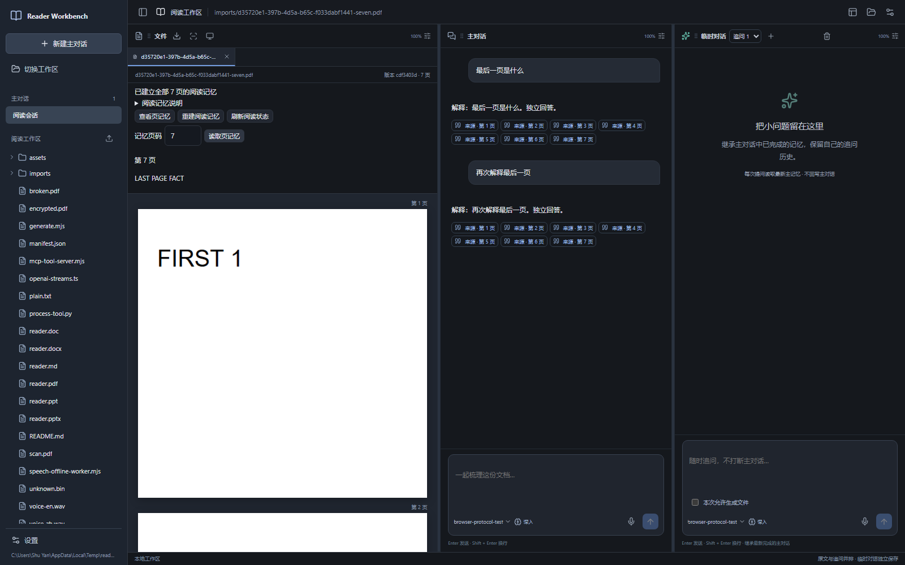

# Reader Workbench

**在一个工作区里读文档、建立逐页记忆，边读边问。**

[](https://github.com/LINYEANSHU/reader-workbench/releases/tag/v0.2.0)
[](https://nodejs.org/)
[](https://github.com/LINYEANSHU/reader-workbench/actions/workflows/ci.yml)

文档、主对话与临时追问并排打开。PDF、Office 和图片先建立本地逐页阅读记忆，后续提问复用记忆，需要时再回看指定页；临时追问读取最新完成的主记忆，并保留自己的追问链。



*0.2.0 浏览器回归截图，使用七页合成文档与协议测试模型，展示界面和记忆流程。真实模型验收另见下方证据。*

## 开始使用

需要 **Node.js 24+**。从 [v0.2.0 Release](https://github.com/LINYEANSHU/reader-workbench/releases/tag/v0.2.0) 下载 `reader-workbench-0.2.0.tgz`，在下载目录运行：

```sh
npm install --global ./reader-workbench-0.2.0.tgz
reader-workbench web
```

或从源码启动：

```sh
git clone https://github.com/LINYEANSHU/reader-workbench.git
cd reader-workbench
npm ci
npm run build
npm start
```

浏览器默认打开 `http://127.0.0.1:4317`。选择一个工作区，打开文档，在设置中填入兼容 OpenAI Chat Completions 的 API 地址、模型与 Key，然后开始提问。视觉阅读记忆需要支持图像输入的模型。

Windows 源码安装并构建后，也可运行 `./Start-Reader.ps1`；`reader-workbench doctor` 可检查本机依赖。完整说明见 [安装与运行](docs/installation.md)。

## 阅读流程

| 文档栏 | 主对话 | 临时追问 |
| --- | --- | --- |
| 浏览文件、预览页面、查看或重建页记忆 | 持续阅读与分析，积累主记忆 | 选字、截图或自由提问，保留独立追问链 |

三栏可拖动排列、上下或左右分割，每栏独立缩放 **50–200%**。选中文字后右键“询问 AI”，或用默认 **Mod+Shift+X** 截图；快捷键可在设置中修改。临时答案不回写主对话，生成文件需开启该次授权。

**0.2.0 的逐页记忆：**

1. 本地准备 PDF、转换后的 Word/PPT 或图片的全部页图像。
2. 首次提问按模型限制一次或分批阅读，保存逐页记忆、页码、不确定内容和全文概览。
3. 后续提问携带本地记忆与历史，必要时只回看指定页；文档栏显示进度，支持查看和重建记忆。

文档内容、工作区、模型与插件提示版本分别隔离。中断后可继续已完成批次；停用插件的设置在重启后保留。Markdown/文字使用文本解析路径；文本模型配合 OCR 时需停用视觉记忆插件。

## 文档、语音与扩展

- **文档：** Markdown、PDF、Word、PPT、图片及生成文件。Office 原版页面预览需要本机 LibreOffice，中文排版也依赖本机字体。
- **语音：** 两个输入框内置离线 SenseVoice。首次使用自动准备约 240 MB 模型；停止录音后转写为可编辑草稿，按发送才调用 LLM。
- **扩展：** 独立插件 SDK 提供 17 类能力接口，随包附视觉文档记忆、术语助手及 Python 工具示例，也可连接外部 MCP。
- **集成：** HTTP API、MCP HTTP Server 和 `reader-workbench mcp` stdio 桥接复用同一服务状态。

原文件保留。生成文件默认位于 `outputs/<session>/`，工作区缓存、记忆与历史位于 `.reader-workbench/`，模型凭据保存在本机私有配置目录。**使用远程 LLM 时，参与提问的文字、记忆和所需页图像会发往你配置的模型服务。** 本地保存记忆不等于模型服务端的持久会话。

## 版本与验证

当前版本 **v0.2.0** · 视觉文档记忆插件 **1.0.0** · SDK 协议 **1.1.0**。

2026-10-12 的 Windows x64 验收记录：类型检查与构建通过，核心测试 **127/127**、浏览器测试 **35/35**，发行包在无源码目录安装通过。授权的两页真实 DeepSeek 预读及后续问答已验证；后续请求发送 **0 张图片**。

这些结果对应记录中的样例和环境。macOS/Linux 实机、人工物理麦克风、OS 手动选择器及可选系统全局热键 helper 尚未完成实测；仓库提供跨平台 CI，状态以 Actions 实际结果为准。

- [变更日志](CHANGELOG.md) · [0.2.0 验收记录](docs/evidence/2026-10-12/visual-document-memory/validation.md) · [真实模型记录](docs/evidence/2026-10-12/visual-memory-live.json)
- [插件 SDK / Python / 外部 MCP](docs/plugins.md) · [HTTP API](docs/api.md) · [MCP Server](docs/mcp.md)
- [验证方法](docs/verification.md) · [版本迭代](docs/versioning.md) · [第三方组件与模型许可](docs/THIRD_PARTY.md)

开发检查：

```sh
npm run typecheck
npm run build
npm test
npm run test:e2e
```

Office 和真实离线语音测试需要对应本地资源，见验证说明。真实 LLM 测试会调用你配置的 API，应按需单独执行。
