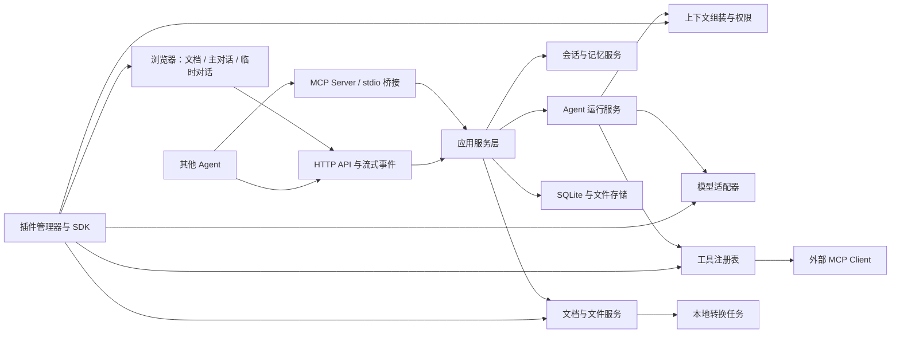

# 阅伴 Reader Workbench：跨平台文档阅读 Agent 设计规格

日期：2026-10-11（Asia/Shanghai）  
阶段：设计方向已确认；本书面规格待用户审阅。  
项目目录：`G:\My_project\try`  
产品代号：Reader Workbench；中文显示名暂采用“阅伴”，后续改名不改变接口。

## 1. 用户目的与已经确认的决策

用户需要一款辅助阅读文件的 Agent。阅读原文、与 Agent 展开主要工作、针对某一知识点随时追问必须能够同时进行。临时追问不能使主对话冗长，也不能修改主对话的记忆。

已经确认：

1. 应用采用本地服务加浏览器界面。macOS、Windows、Linux 使用同一套应用，通过命令行启动。
2. 文件、主对话、临时对话三个面板可以手动排列并调整宽度。
3. 临时对话每次提问读取主对话最新记忆，同时保留自己的追问历史；它不回写主对话。
4. Word/PPT 接受在本机后台转换，优先保留原版页面与版式，原文件保留。
5. 参考 DeepSeek Harness 的插件架构，建立独立内核及插件 SDK，不要求直接兼容其现成插件。
6. 应用需要可供其他 Agent 调用的功能接口。采用 HTTP API 加 MCP Server，并支持应用调用外部 MCP 工具。

对 iOS 的解释：电脑上的服务可以供 iPhone/iPad 浏览器访问；iOS 不承担本地命令行服务的运行。宽屏提供同时可见的三栏，小屏保留三个面板并支持切换、折叠和横屏查看。

成功标准是实际可启动、可阅读四类文件、可连接真实 LLM API、可独立追问、可安装示例插件、可从另一个 MCP 客户端调用。界面模型或仅有接口声明不构成交付。

## 2. 实现范围与边界

首版完整交付范围：

- 本地 Web 应用、跨平台启动入口、依赖诊断命令。
- Markdown、PDF、Word（`.doc`、`.docx`）、PowerPoint（`.ppt`、`.pptx`）导入与预览。
- 原文件和 Agent 生成文件的多标签文档栏，以及打开、切换、下载和来源追踪。
- 主对话与临时对话的流式回答、停止、错误恢复、持久保存。
- 文档选区提问、页码/段落引用及从回答返回原文。
- 可配置的 OpenAI-compatible API 适配器；其他协议通过模型插件接入。
- 文档读取、检索、生成 Markdown 文件和导出 Word/PPT/PDF 的内置工具。
- 具备真实加载、启用、停用能力的插件 SDK、设置界面、示例插件及开发说明。
- HTTP API、MCP Server 和外部 MCP Client 接入。
- 安装、使用、配置、插件开发、其他 Agent 接入及验证说明。

首版按个人本地工作台设计。局域网设备属于同一用户的访问端；公开互联网部署、多用户账号/计费和协同编辑不属于当前需求。文档以阅读为主，不实现完整的 Office 编辑器。

任意生成文件均可登记、在文件栏打开、查看元数据并下载。内置预览器覆盖上述四类文件、常见图片和纯文本；其他格式通过预览器插件扩展。无预览器时明确显示格式及下载入口，不将文件元数据冒充文档正文。

## 3. 总体架构

采用 TypeScript 为主要开发语言，Node.js 24 LTS 为服务运行时，React 与 Vite 构建浏览器界面。HTTP 服务使用 Fastify，持久化使用 SQLite；数据库访问被存储接口封装。PDF 的解析与浏览器渲染使用 PDF.js，Office 本地转换由 LibreOffice 适配器提供。

内核管理注册、依赖、会话、运行生命周期和事件。模型、文档处理、工具、导出器及扩展界面均通过能力接口组合。Web、HTTP 客户端、MCP 调用共用同一服务层，避免出现三份业务逻辑或互相看不到的会话。

模块的独立职责：

| 模块 | 职责 | 对外契约 |
| --- | --- | --- |
| 启动器 | 读取配置、检测依赖、启动服务、打开浏览器 | CLI 与配置 schema |
| 文件服务 | 保存原文件、版本、生成文件及访问授权 | 文档/文件 ID，不暴露任意磁盘路径 |
| 文档处理 | 类型识别、转换、解析、索引、页面内容 | DocumentAdapter 与 ViewerDescriptor |
| 会话服务 | 主/临时会话、消息、记忆快照、持久化 | SessionRepository 与 ContextEnvelope |
| Agent 运行 | 调用模型、执行工具、流式输出、取消 | RunService 与运行事件 |
| 插件管理 | 加载、依赖检查、权限、注册与卸载 | PluginManifest 与 PluginContext |
| 接口层 | HTTP、流式事件、MCP 工具与资源映射 | 有版本的 API schema |
| 浏览器界面 | 三栏布局、文档查看、输入与状态 | 仅调用接口层 |

## 4. 启动与跨平台行为

安装依赖并构建后，日常通过一条启动命令打开 Web 工作台。启动器提供 `web`、`doctor`、`mcp` 子命令；最终命令拼写以实现计划和交付 README 为准，本节描述其行为契约。

- `web`：检测端口与数据目录，启动服务，默认监听 `127.0.0.1`，打开系统默认浏览器；支持 `--no-open`、`--port`、`--host`、`--data-dir`、`--workspace`。
- `doctor`：显示 Node 版本、本地转换引擎及配置状态；缺失依赖给出各平台可操作的说明。
- `mcp`：通过标准输入输出桥接到指定的已运行应用；共享同一个文档与会话状态，日志只写 stderr。

路径处理使用平台路径 API。启动器不依赖 PowerShell、Bash 或 Windows COM；调用外部程序使用独立参数数组，不拼接 shell 命令。Windows 启动后台程序不弹出额外窗口。

Office 转换需要 LibreOffice。自动发现系统安装路径，也允许指定转换器路径。首次环境准备与后续一条命令启动应在说明中分别写清楚；缺失转换器时仍能启动并使用 Markdown/PDF，同时明确告知 Office 预览不可用及修复步骤。最终宣称支持 Office 时必须有实际转换成功证据。

## 5. 三栏工作区与阅读交互

默认顺序为“文件—主对话—临时对话”，三个面板均有标题、独立滚动区域和状态提示。

- 拖动面板标题可改变顺序，支持全部六种排列；同时提供键盘/菜单操作。
- 拖动分隔线改变宽度；宽屏最低宽度保证内容和输入框可用。布局在刷新后恢复。
- 文件栏可以打开多个原文件及生成文件标签。切换文件保留各自页码、缩放与滚动位置。
- 选中文本后，提供“在临时对话中提问”动作，携带文件版本、页码/段落标识与选区文本。
- 无可选文本的页面可以选择当前页/区域作为图像上下文。
- 回答中的来源引用可以跳转到对应文件和页面/段落。无可靠位置的引用不伪造页码。
- 临时栏可创建多个独立追问分支、切换或清空当前分支；主对话的位置和历史不受这些操作影响。
- 手机/窄屏保留同样的数据与动作，改用可切换的面板布局，不让输入框或文档内容挤出屏幕。

可见状态包括：文档转换/索引进度，正在回答、工具执行、失败、取消，临时对话引用的主对话版本，及上下文是否使用摘要。

## 6. 文档导入、转换、解析与索引

浏览器通过文件选择器或拖放上传；本地 API/MCP 可从授权 workspace 导入文件。上传后保留原始字节，计算 SHA-256，以文档 ID 与内容版本关联缓存。重名文件不覆盖，原件不在转换或生成过程中修改。

| 文件类型 | 预览 | Agent 可用内容 | 定位方式 |
| --- | --- | --- | --- |
| Markdown | 渲染标题、表格、代码、链接与数学内容 | 正文与结构块 | 标题、段落/行范围 |
| PDF | 页面渲染、文字层、缩放、页码 | 文字块、页图像、页面元数据 | PDF 页码与可用坐标 |
| Word | 本地转换为 PDF 后显示页面 | 转换后的页文字与页图像；保留源文件关联 | 预览页码与版本 |
| PPT | 本地转换为 PDF 后逐页显示 | 幻灯片文字与页图像；可用时提取备注 | 幻灯片页码与版本 |

Office 转换任务具有独立工作目录与 LibreOffice profile，受任务队列、超时、取消和输出检查管理，不占用用户正在打开的 Office 文档。缓存按源文件哈希、转换器版本及配置识别，不能把旧内容当作新文件。

显示版式目标是尽量保留原页面的图片、表格、公式和布局。字体缺失、不同排版引擎造成的差异必须通过实际样例核对；不能宣称逐像素等同 Microsoft Office。PPT 以静态幻灯片阅读为本阶段行为，动画/转场不作为预览验收项。

文档按页面与结构块建立全文索引。用户选择的片段优先进入上下文，相关页面通过检索补充；完整文档仍可按页读取。索引不把抽取顺序混乱的 PDF 文字冒充正确版式，页面图像是视觉内容的依据。

扫描 PDF 和图片页面始终可预览。视觉模型可接收选定页面/区域图像；无视觉能力时通过 OCR 插件提取文字。若两者均不可用，明确报告缺少可读文字，不能生成假装看过图像的答案。图像上下文有大小与页数上限，并显示实际发送的页面范围。

## 7. 主对话、临时对话与记忆隔离

主会话和临时会话使用独立 session ID、消息记录、运行记录和自身摘要。临时会话保存 `parentMainSessionId`，但不共享可变消息数组或可写父会话对象。

每次临时提问按以下顺序生成不可变请求上下文：

1. 读取请求开始时已经提交的完整主对话轮次及其记忆，记录 `mainRevision`。
2. 读取当前文档与选区的确定版本，记录 `documentVersions` 和定位信息。
3. 读取当前临时会话自己的历史；其中保留追问链，不能再次复制旧的主对话快照导致重复堆积。
4. 组装新的 ContextEnvelope 并固定本次请求；主对话之后的更新进入下一次临时请求。
5. 临时用户消息、回答、工具结果和摘要仅写入当前临时会话。

正在流式生成且尚未提交的主对话回答不属于本次继承内容，界面可以显示主对话仍在运行。主对话完成后，下次临时请求继承新版本。

隔离是存储服务和工具执行权限保证的行为，不能仅靠提示词“不要写回”。临时上下文只获得父会话的读取能力，不能取得主会话的追加、修改、删除、摘要写入或主会话工具状态的写权限。其默认工具集为读取/检索；临时生成文件使用自身命名空间，只有用户主动打开或附加时才改变对应界面或主会话附件。

临时回答默认简短：以直接解释、必要的公式/例子和来源定位为主，约 100–300 个中文字符为软目标；用户主动要求展开时可以增加篇幅。输出限制可配置，不能以硬字符截断破坏答案。

清空/删除临时分支不修改主对话。首版不自动把临时内容总结进主对话；用户可以手动复制结果。

## 8. 长对话与“继承所有记忆”的实际含义

完整会话记录持久保存，并可查询；一次模型请求受所选模型上下文容量限制。

- 容量足够时，使用完整主对话和当前临时历史。
- 容量不足时，组合带来源范围的摘要、近期轮次、当前选区和检索结果。
- 旧记录保留在存储中，并通过历史读取工具访问，不因摘要而删除。
- 主对话摘要与临时摘要分别保存。临时请求不得为了压缩上下文更新父会话摘要；必要的请求内摘要只写入临时命名空间。
- 界面显示实际继承的主对话版本、摘要范围和检索情况，避免把有限上下文描述为一次性送入了无限历史。

记忆、检索和上下文转换均通过插件接口扩展，必须保留来源信息与隔离约束。

## 9. LLM 接入与 Agent 运行

设置界面配置 provider、base URL、模型名称、凭据来源、上下文容量、输出上限及视觉/工具调用能力。首个真实适配器覆盖 OpenAI-compatible Chat Completions API，可用于相应兼容端点；其他协议由模型插件实现。

API Key 保存在服务端配置或环境变量中，浏览器只得到已配置状态与掩码；日志、导出文件和外部 MCP 资源不得返回凭据。配置文件使用适当的本地权限。

运行生命周期：`queued → running → completed | failed | cancelled`。同一会话的写入与运行按顺序协调；不同临时分支可以独立运行。流式事件带 run ID、会话 ID 与事件序号。

Agent 可注册工具并执行模型发起的工具调用。工具输入按 schema 校验，工具结果进入所属会话。具有文件生成或其他副作用的工具不在失败后盲目重复执行；使用执行 ID 与幂等记录追踪结果。取消应同时停止网络请求及所属转换/工具任务。

模型连接错误、认证失败、限流、上下文超限和工具失败显示可识别原因。保留已提交记录及失败状态；失败/取消产生的半段回答有明确标记，不伪装成完成结果。服务重启后把尚未完成的运行标记为中断，并允许用户发起新请求。

测试用确定性适配器仅在测试/显式演示模式启用，界面显示该模式。没有真实 API Key 时不能把模拟回答作为真实 LLM 验收证据。

## 10. Agent 生成文件与文件服务

内置读取工具负责页面读取、文档检索与会话历史读取。生成工具提供：

- 写入 Markdown/纯文本阅读件，包含源文档和可用页码/段落引用。
- 从结构化内容导出 `.docx`、`.pptx`、`.pdf`；导出器通过插件注册。
- 在文件栏打开生成结果，并支持下载、切换回原文件和查看来源关系。

生成文件保存为新 Artifact，记录所属会话、运行、源文档版本、MIME 类型及哈希，不能覆盖原文件。长文档翻译等任务可以逐段/逐页生成并报告进度；任务未完成或部分失败时标注覆盖范围，不能把部分翻译称为全文完成。

文件预览使用同一文档服务，所以 Agent 生成的 Word/PPT/PDF 必须能够重新打开并通过同样的解析与转换检查。

## 11. 独立插件 SDK

插件 manifest 包含：唯一 ID、版本、SDK/API 兼容范围、入口、依赖、设置 schema 和声明的能力/权限。插件具有 `activate(context)` 与释放/停用生命周期。

实现的扩展契约包括：

| 扩展点 | 可注册能力 | 约束 |
| --- | --- | --- |
| ModelProvider | 模型发现、能力声明、流式生成、取消 | 标准化消息/工具结果，不泄露 Key |
| DocumentAdapter | 文件类型识别、解析、转换与结构块 | 版本化文件输入和可定位输出 |
| ViewerProvider | 注册文件预览描述 | 内容类型明确，HTML 经过安全处理 |
| ToolProvider | 带 schema 和影响声明的工具 | 运行身份和会话权限校验 |
| ArtifactExporter | 从结构化内容生成文件 | 新文件命名空间与来源元数据 |
| MemoryProvider | 摘要、历史读取、检索 | 不改变会话所有权 |
| ContextTransform | 请求前的上下文变换 | 保留来源；只能操作请求副本 |
| StorageProvider | 存储适配 | 事务、版本及隔离行为保持一致 |
| LifecycleHooks | 启动、文档导入、运行事件等 | 不阻塞无关会话；错误可观察 |
| UIContribution | 工具栏动作、设置字段、扩展视图描述 | 使用有版本的声明式协议 |

加载时验证版本、依赖与权限，依赖环和重名能力给出明确错误。停用释放其工具、监听器和界面贡献，正在使用插件的运行不能失去结果归属。插件配置与状态以插件 ID 隔离。

首版提供可安装的本地示例插件，至少演示一项 Agent 工具、一项界面动作和一个有设置的扩展能力，并通过实际运行验证注册/停用。

SDK 的逻辑权限约束不等于针对恶意插件代码的操作系统沙箱。插件安装属于加载本地代码，不能宣称任意第三方代码天然安全。当前不建设远程插件市场；本地目录/包安装及开发指南足以验证扩展机制。

## 12. HTTP API、MCP Server 与外部 MCP Client

HTTP API 使用 `/api/v1`，提供版本化输入/输出 schema。主要能力：

- 配置与运行时能力查询。
- 文档导入、列表、原文件/预览读取、页面/结构块读取、检索。
- 主会话创建与读取，临时分支创建与读取。
- 提交问题、订阅运行事件、取消运行、获取完成结果。
- 文件列表、生成结果读取/下载。
- 插件列表、设置、启用与停用。

MCP Server 暴露相同服务的工具与资源，例如 `open_document`、`read_document_page`、`search_document`、`create_reading_session`、`ask_main`、`ask_temporary`、`get_run`、`cancel_run`、`list_artifacts` 和 `open_artifact`。长任务返回 run ID，可读取任务状态或订阅事件，不以长时间阻塞一次 MCP 调用作为唯一交互方式。

默认提供 Streamable HTTP；stdio 子命令是连接同一个运行中服务的桥接器。资源使用文档、会话和文件 ID，不开放任意磁盘读取或 Key 资源。外部调用带 actor/caller 来源，所有写入遵守相同的会话权限和运行限制。

内置 MCP Client 插件支持配置外部 stdio 与 Streamable HTTP 服务，发现工具/资源并注册到工具系统。注册名包含服务器命名空间，断连与工具 schema 变化有可见状态。临时对话仍受只读能力约束，不能借外部 MCP 工具绕过父会话隔离。

HTTP API 与 MCP 是两种调用方式，不复制 Agent 内核。额外 Agent 协作协议可通过传输适配器扩展，本阶段无须实现另一套完整调度系统。

## 13. 持久化、访问与文件权限

SQLite 存储工作区、文档版本、主/临时会话、消息、摘要、运行、插件配置、模型配置引用和布局。原件、预览缓存、页面图像、生成文件分目录保存，数据库记录其稳定 ID 与哈希。

写入消息与推进会话 revision 具有事务一致性。重启后恢复对话、文件标签与阅读位置；临时历史的恢复不向主对话追加内容。

默认仅监听本机。浏览器访问使用本地会话认证，外部 API/MCP 使用访问令牌；开启局域网监听需要明确配置，仍有认证和来源检查。令牌不写入文档、聊天内容或普通日志。

磁盘导入限制为授权 workspace 和上传目录，解析真实路径并检查目录边界；拒绝路径穿越及越界符号链接。文件下载由 ID 查询已登记文件。浏览器展示的 Markdown/HTML 不允许执行文档脚本；文档中的指令当作内容，不能改变工具权限。

## 14. 错误与兼容处理

- 转换器缺失或失败：保留原件、显示原因和修复入口，其他会话继续工作。
- 加密/损坏文件：明确报告，不能以空正文当作成功解析。
- 字体/版式差异：提供转换状态与原文件下载，记录验证中的实际差异。
- 模型能力不匹配：图像或工具调用前按能力检查，提示更换适配器/模型。
- 插件加载失败：只停用对应插件，保留配置和错误，核心工作台仍可启动。
- 端口占用、数据目录无权限：启动阶段给出明确错误及可选参数。
- 网络断开或页面刷新：从运行 ID 与事件序号恢复状态；不得再次提交同一个问题造成重复写入。

## 15. 验收与证据要求

| ID | 验收要求 | 需要的实际证据 |
| --- | --- | --- |
| R01 | 一条命令启动可用 Web 工作台 | 安装/构建日志、CLI 启动、真实 HTTP 与浏览器打开 |
| R02 | Windows/macOS/Linux 兼容入口 | 平台测试矩阵；实际运行的平台与未实际运行的平台分别记录 |
| R03 | 三栏可排序、调整宽度并恢复 | 浏览器验证六种顺序、分隔线调整、刷新恢复与截图 |
| R04 | 四类文件能在应用内阅读 | 含图片、表格、公式的 MD/PDF/DOCX/PPTX 样例；旧 DOC/PPT 转换样例；页面检查 |
| R05 | 原件不被更改，缓存版本正确 | 导入/转换前后源 SHA-256、更新版本后的缓存验证 |
| R06 | 主/临时均可连接真实 LLM | 实际 API 请求与流式回答；无 Key 时明确标为尚未实测 |
| R07 | 临时继承最新主记忆且保留追问链 | 主对话更新后再次追问，核对实际 ContextEnvelope 的版本与消息来源 |
| R08 | 临时不改变主对话 | 临时提问、失败、取消、清空、摘要及工具调用前后主记录/revision/工具状态一致 |
| R09 | Agent 能看到选区/页面并引用来源 | 文本选区问答、图像页能力检查、点击引用返回正确原文 |
| R10 | 长文档/长历史完整记录可查询 | 触发上下文容量限制，确认摘要提示、原记录可读取与检索覆盖 |
| R11 | 生成文件可再次打开 | Markdown、DOCX、PPTX、PDF 输出；重新导入/预览并核对来源 |
| R12 | 插件是实际可用扩展机制 | 示例插件加载、工具被调用、界面动作出现、设置保存、停用后释放 |
| R13 | 其他 Agent 可以调用应用 | 独立 HTTP 客户端与 MCP SDK 客户端执行文档读取、提问和结果获取 |
| R14 | 应用可调用外部 MCP 工具 | 测试 MCP 服务发现/执行/断连；临时会话写工具被拒绝 |
| R15 | 保存、重启、错误与取消正确 | 会话恢复、转换失败、模型错误、运行取消和重复请求测试 |
| R16 | 文件与凭据访问边界有效 | 越界路径/链接、无认证请求、文档脚本、Key 不泄露的验证 |
| R17 | iPhone/iPad 浏览器可访问布局 | Safari/WebKit 与窄屏测试；真实设备验证情况单独说明 |

业务不变量使用单元/集成测试验证；文档版式与三栏交互必须进行实际渲染/浏览器检查，不能只依据类型检查和构建成功。测试模拟模型与真实 API 证据分别记录。

当前执行环境为 Windows、Node.js v24.21.0。尚未运行应用、尚未安装项目依赖，也没有真实 LLM 请求或 macOS/iOS 设备实测。交付时不得把设计目标、CI 文件或模拟测试描述成这些实测已经完成。

## 16. 交付物

1. 可安装、构建和启动的应用源码与锁定的依赖。
2. 跨平台 CLI、Web 界面及本地持久化服务。
3. 版本化 HTTP API 和 MCP 连接配置示例。
4. 插件 SDK、示例插件、模型/文档/工具扩展说明。
5. 样例文档与生成文件，用于重复验证。
6. 使用 README、安装/转换依赖说明和测试报告。
7. 测试、浏览器截图与逐项验收记录，明确仍需用户凭据或外部设备才能验证的项目。

实施计划以本规格全部 R01–R17 为追踪对象；不能把后续接口预留替代本规格明确要求的可运行能力。

## 17. 参考依据

以下是设计时核对的官方/项目原始资料，核对日期为 2026-10-11。它们提供架构或实现依据，不代表本应用已完成。

- [DeepSeek Harness 官方仓库](https://github.com/deepseek-ai/deepseek-harness)：插件组合与本地 Web 启动方式；其当前为开发者预览，本项目独立实现 SDK。
- [DeepSeek Harness Agent API](https://github.com/deepseek-ai/deepseek-harness/blob/master/packages/core/agent/README.md)：Agent 与驱动、工具作用域的分离。
- [DeepSeek Harness Session API](https://github.com/deepseek-ai/deepseek-harness/blob/master/packages/core/session/README.md)：可重构记录、会话派生和快照分支。其固定快照 fork 不能直接替代本应用的动态继承规则。
- [DeepSeek Harness MCP 模块](https://github.com/deepseek-ai/deepseek-harness/blob/master/packages/mcp/README.md)：调用外部 MCP 的角色与本应用对外 Server 的角色不同。
- [MCP 官方 Server 文档](https://modelcontextprotocol.io/docs/develop/build-server) 与 [TypeScript SDK](https://github.com/modelcontextprotocol/typescript-sdk)：工具、资源、服务端/客户端与传输实现依据。
- [Mozilla PDF.js](https://github.com/mozilla/pdf.js)：PDF 解析与浏览器渲染。
- [LibreOffice 平台要求](https://www.libreoffice.org/system-requirements/)、[命令行启动参数](https://help.libreoffice.org/latest/en-US/text/shared/guide/start_parameters.html) 与 [PDF 导出参数](https://help.libreoffice.org/latest/en-US/text/shared/guide/pdf_params.html)：跨平台本地转换依据。
- [Node.js 下载与平台分发](https://nodejs.org/en/download)：服务运行时分发依据。

## 18. 规格自审结果

- 已纳入用户确认的本地 Web、独立 SDK、动态记忆继承与本地转换决定。
- 将动态继承与固定快照 fork 区分；每次请求固定版本，下一次读取最新版本。
- 将查看器、文档解析、生成文件和未知格式处理的行为分别明确。
- 将供外部 Agent 调用的 MCP Server 与调用外部工具的 MCP Client 分别明确。
- 对真实模型请求、Office 版式与跨平台实测规定了证据要求。
- 未把无法验证的平台运行或模型调用写成已经成功；未使用待定占位符代替关键行为。
